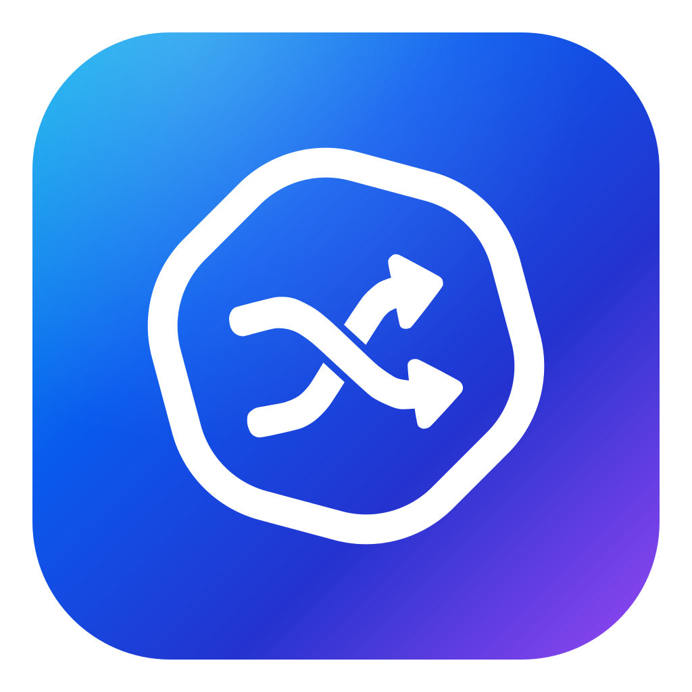
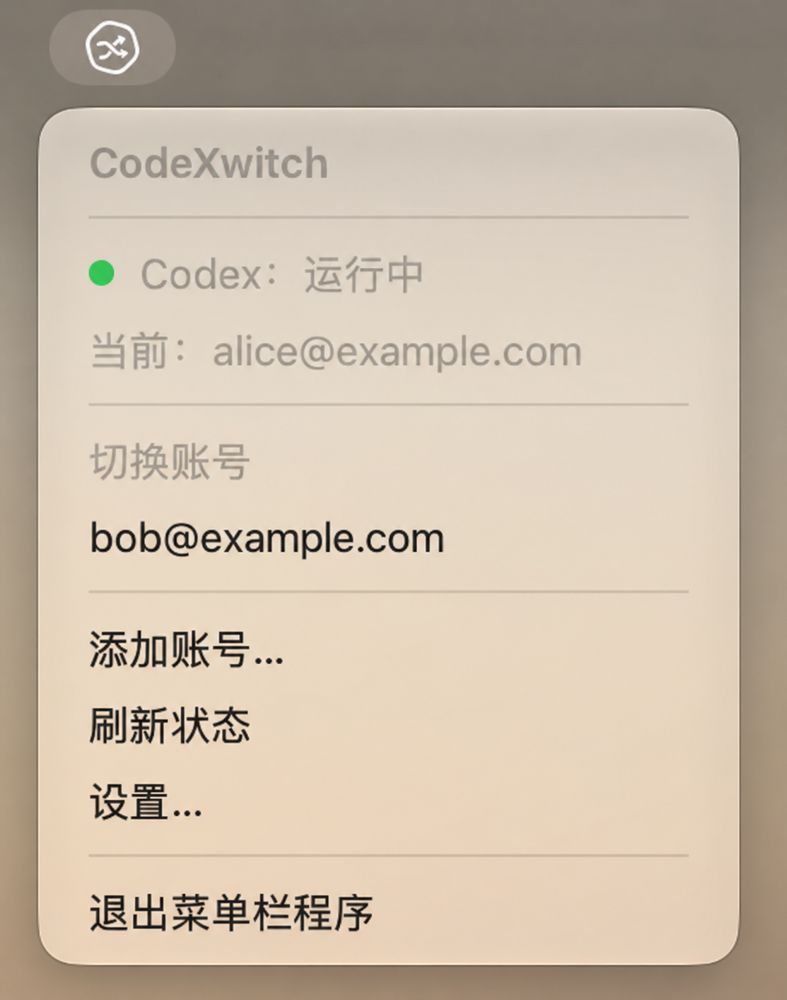

<p align="center">
  
</p>

# CodeXwitch

**一键切换 Codex 登录账号。**

CodeXwitch 是一个原生 macOS 菜单栏工具、Codex 启动器。它保存本机已登录账号的凭据，在你选择另一个账号时，正常退出 Codex、替换认证文件，然后重新打开原来的 App。配置、项目和会话继续使用原目录。

CodeXwitch 是独立的第三方项目，与 OpenAI 没有隶属或背书关系。它不自动按额度轮换账号，也不显示剩余额度。

<p align="center">
  
</p>

## 功能

- 自动识别从 Dock、Finder 等其他入口启动的 Codex。
- 登录后自动保存账号，并跟随磁盘中的凭据刷新更新保存记录。
- 在下拉菜单中查看当前账号、选择备选账号，或启动已停止的 Codex。
- 添加账号时在原 Codex App 中完成官方登录。
- 在设置窗口中删除已保存账号，查看程序版本。
- 显示准备、等待退出、切换和启动等操作阶段。


## 安装

需要 macOS 13+，并已安装可正常运行的官方 Codex。预编译包目前提供 Apple Silicon（arm64）版本。

[下载 CodeXwitch 0.1.6（Apple Silicon）](https://github.com/Cuizi7/CodeXwitch/releases/download/v0.1.6/CodeXwitch-0.1.6-macos-arm64.zip)

解压下载的应用包，将 `CodeXwitch.app` 拖入 Applications 后打开。程序常驻菜单栏，不显示 Dock 图标。

当前应用未公证。如果 macOS 阻止打开，请在确认来源可信后，按系统“隐私与安全性”提示处理，参见 [Apple 说明](https://support.apple.com/102445)。

<details>
<summary>从源码构建</summary>

需要包含 Swift 6 工具链的 Xcode。在项目根目录运行：

```sh
bash scripts/build-app.sh
open build/CodeXwitch.app
```

</details>

更新时先退出 CodeXwitch，再替换应用并重新打开，已保存账号会保留。卸载时退出并删除应用；如需清除账号记录，再删除 `~/Library/Application Support/CodeXwitch/`。

## 使用

1. 在 Codex 中登录，再打开 CodeXwitch，当前账号会自动保存。
2. 点击“添加账号…”，在重新打开的 Codex 中登录另一个账号。
3. 点击菜单中的备选账号，即可切换。放弃添加时，也可以选择已保存账号切回。
4. 在“设置…”中删除不需要的账号记录。删除记录不会退出当前 Codex。

切换前请完成 Codex 中正在执行的任务。如果弹出退出确认，请在 60 秒内确认，超时会停止切换。

## 注意事项

- 目前仅支持默认 `~/.codex` 目录中的 ChatGPT 文件认证，不支持 API key 或自定义认证目录。
- VS Code 扩展或独立 CLI 若共用认证，切换前请自行退出。
- 凭据仅保存在本机，未额外加密。请勿公开 `~/Library/Application Support/CodeXwitch/` 中的文件。

## 更新日志

- **0.1.6**：修复移动应用后可能无法加载图标的问题。
- **0.1.5**：菜单显示应用名称，设置中显示版本号。
- **0.1.4**：新增 App 图标和菜单栏状态图标。
- **0.1.3**：修复退出后重新启动，显示切换进度。
- **0.1.2**：修复退出误判，增加 60 秒确认等待。
- **0.1.1**：增加诊断日志。
- **0.1.0**：支持自动保存、添加、切换和删除账号记录。

## 许可证

[MIT License](LICENSE)。
